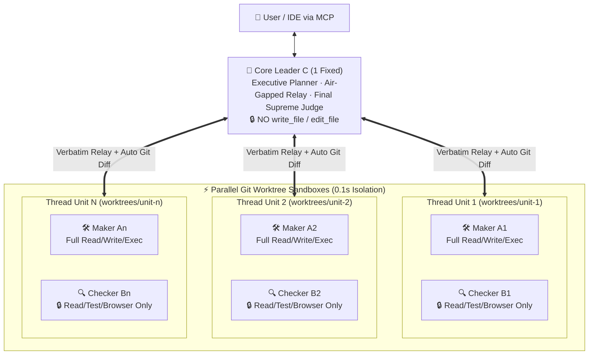
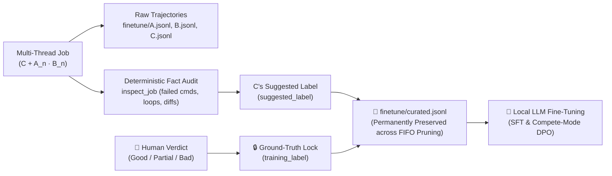

# The `CKD` Theory: Air-Gapped Triadic Verification & Closed-Loop Knowledge Distillation

> **Originated & Architected by**: **[AXNli Inc. (`주식회사 에이엑스엔엘아이`)](https://axnli.com)** : *Systems for Data & AI*  
> **Reference Implementation**: **Herdr CKD** (Open-Source [Herdr `OSC 7501`](https://github.com/herdrdev/herdr) Runtime + `CKD` Multi-Thread Engine)

---

## 1. Key Distinction Upfront & Why Existing Paradigms Hit a Ceiling

> [!IMPORTANT]
> **Crucial Clarification: `CKD` is NOT "Multiple Chat Threads in a Project" (like Claude Projects or Gemini)!**
> * Opening multiple threads in Claude, Gemini, or ChatGPT means **a human manually juggling separate chat tabs**, where each tab remains an unverified single-agent conversation.
> * In **`CKD` (`Herdr CKD`)**, **the human talks only once to a single Core Leader (`C`)**. Behind that single prompt, `C` internally decomposes the goal into isolated Maker : Checker pairs (`[A1·B1], [A2·B2]...`), enforces independent verification, and merges all verified units into **one cohesive deliverable**.

Over the past two years, autonomous coding tools have converged into two dominant paradigms : and both suffer from structural epistemic flaws that prevent reliable, unattended execution on local or frontier LLMs:

1. **The Single-Agent Harness Fallacy (*e.g., SWE-agent, Aider, Claude Code / Cursor single loops*)**
   - A single context window plans, edits files, runs tests, and judges its own output (`Plan → Edit → Run → Self-Check`).
   - **Failure Mode : Self-Confirmation Bias**: Because the same token probability distribution that authored a bug is asked to verify the code, the agent rationalizes failures, weakens test assertions to make them pass, or hallucinates completion.
   - **Failure Mode : Context Pollution**: Stack traces and dead-end edits accumulate in one session, degrading attention over long horizons.

2. **The Chat-Room Multi-Agent Fallacy (*e.g., AutoGen, CrewAI, naive role-play swarms*)**
   - Multiple agents ("Coder", "Reviewer", "PM") converse directly in a shared chat thread, differentiated only by system-prompt personas.
   - **Failure Mode : Sycophantic Groupthink (Peer Contagion)**: When "Coder" persuasively claims a feature works, "Reviewer" is conditioned by the shared conversational history to agree without independent verification.
   - **Failure Mode : Prompt-Only Boundaries**: A "Reviewer" that still possesses file-editing tools or shares state with the "Coder" inevitably crosses role boundaries.

---

## 2. Paradigm Comparison: Agent Harnesses vs. Multi-Agent Swarms vs. `CKD` Theory

**CKD** (*Collaborative Knowledge Distillation & Cross-Verified Role Separation*), created by **[AXNli Inc.](https://axnli.com)**, replaces prompt-level role-play with **runtime-enforced separation of powers**, **air-gapped communication**, and **unanimous triadic convergence**:

| Architectural Dimension | Single-Agent Harness (`SWE-agent`, etc.) | Chat-Room Multi-Agent (`AutoGen`, `CrewAI`) | **`CKD` Theory by AXNli Inc. (`Herdr CKD`)** |
| :--- | :--- | :--- | :--- |
| **Role Topology** | 1 Agent does everything | N Agents chatting in a shared room | **`1 Fixed Core (C)` + `N Parallel [A_n · B_n] Pairs`** |
| **Communication Rule** | Self-talk in 1 context | Direct peer-to-peer chat (`A ↔ B`) | **Strict Air-Gap**: `A_n` and `B_n` **never** talk directly; `C` relays verbatim |
| **Tool Privilege Enforcement** | Full write/exec in one loop | Usually prompt-based ("please don't edit") | **Physical Runtime Stripping**: `B_n` & `C` have `write_file`/`edit_file` removed at runtime |
| **Evidence Hand-off** | Agent summarizes its own work | Agent pastes claims into chat | **System Fact Injection**: `C` auto-extracts immutable `git diff` & exit codes into `B_n`'s prompt |
| **Definition of `1 Round`** | 1 tool call or 1 test run | 1 turn of conversation | **`[Inner Loop until A_n + B_n both declare DONE]` + `[Outer Integration Audit by C]`** |
| **Completion Condition** | Agent says "Done" | Reviewer says "LGTM" | **Unanimous Triad (`A = DONE` ∧ `B = DONE` ∧ `C = PASS`)** across infinite (`0`) or `N` rounds |
| **Post-Job Artifact** | Disposable raw logs | Disposable chat transcripts | **Curated SFT/DPO Dataset (`finetune/curated.jsonl`)** with human ground-truth locks |

---

## 3. The Four Formal Axioms of the `CKD` Theory

### Axiom 1: Physical Separation of Powers (`C ≠ A ≠ B`)

CKD divides agency into three mutually exclusive epistemic authorities : modeled after constitutional separation of powers:

- **`C` (Coordinator / Relay / Final Judge : 1 Fixed Core)**:
  - The sole entity allowed to communicate with the user, decompose the task (`split` or `compete`), relay messages between `A_n` and `B_n`, and issue the final integration verdict (`PASS` / `FAIL`).
  - **Physically barred from modifying files** (`write_file` and `edit_file` do not exist in `C`'s tool registry).
- **`A_n` (Maker / Implementation Worker : `A1, A2, ... An`)**:
  - Executes code changes strictly inside its isolated `Git Worktree` (`worktrees/unit-n`).
  - Cannot communicate directly with `B_n` and cannot declare final job completion on its own.
- **`B_n` (Checker / Dedicated Adversarial Auditor : `B1, B2, ... Bn`)**:
  - Paired 1:1 with `A_n`. **Physically barred from modifying files**.
  - Must inspect the system-injected `git diff`, execute real commands (`run_command`), or inspect headless browser rendering (`browser_check`) to issue `DONE` or `NEEDS_FIX`.

---

### Axiom 2: Air-Gapped Verbatim Relay & System Fact Injection

Why must `A_n` and `B_n` never talk directly?
- If `A_n` and `B_n` share a conversation, `A_n`'s intermediate excuses and framing bias `B_n`'s attention.
- In CKD, `A_n` and `B_n` live in **completely separate `RoleSession` contexts**.
- When `A_n` reports `DONE`, the CKD runtime automatically runs `git status` and `git diff` on `A_n`'s worktree and injects the raw diff block (`[Auto-Extracted Git Diff]`) alongside `A_n`'s claim through `C` to `B_n`. Even if `A_n` claims *"I updated `game.js`"*, `B_n` immediately sees `[Note: No file changes detected]` if no file was actually written.

---

### Axiom 3: The Two-Tier Convergence Loop (`1 Round` Definition & Unanimous `A · B · C` Completion)

Unlike linear pipelines that stop after a single review, CKD defines a rigorous **Two-Tier Convergence Loop**:

```mermaid
sequenceDiagram
    autonumber
    participant C as 👑 Core Leader C (1 Fixed)
    participant A as 🛠️ Maker A_n (Worktree)
    participant B as 🔍 Checker B_n (Auditor)

    rect rgb(25, 33, 48)
    Note over C,B: 🔄 START OF 1 CKD ROUND (Repeats infinitely if maxRounds=0, or up to N rounds)
    C->>A: 1. Assign unit specification & completion criteria
    
    loop Inner Ping-Pong Loop (Unbounded until BOTH A_n and B_n declare DONE)
        A->>C: 2. Implement in Git Worktree & report status (DONE / WORKING)
        C->>B: 3. Relay A_n's report + System-Extracted Git Diff
        B->>C: 4. Audit files, run tests/browser → Issue NEEDS_FIX or DONE
        opt If B_n issues NEEDS_FIX (or A_n is not DONE)
            C->>A: 5. Relay B_n's exact findings (with C's deadlock diagnosis if streak >= 3)
        end
    end

    Note over A,B: ✅ Inner Loop Converged: A_n = DONE and B_n = DONE
    C->>C: 6. Merge passing worktrees & run Final Integration Verification tools
    alt C declares FAIL (Integration issue found)
        C->>A: 7a. End of Round 1 → Send rework instructions for Round 2
    else C declares PASS (No issues found)
        Note over C,B: 🏆 UNANIMOUS COMPLETION: A (DONE) + B (DONE) + C (PASS) = JOB COMPLETED!
    end
    end
```

1. **Inner Ping-Pong Loop (`A_n ⇄ C ⇄ B_n`)**:
   - `C` instructs `A_n` → `C` relays `A_n`'s work to `B_n` → `B_n` audits and declares `NEEDS_FIX` or `DONE` → if there is any issue, `C` relays `B_n`'s review back to `A_n` to fix.
   - This inner loop repeats until **both `A_n` and `B_n` declare `DONE`**.
2. **Outer Integration Check (`= 1 Round`)**:
   - Once `A_n` and `B_n` both declare `DONE`, **`C` inspects everything accomplished so far** using verification tools.
   - If `C` finds a problem (`FAIL`), `C` sends rework instructions back to `A_n`, triggering a new inner ping-pong cycle. **This entire cycle constitutes `1 Round` (`1회차`)**.
3. **Unanimous Triad Completion (`A + B + C`) & Infinite Loop Option**:
   - The task is completed **if and only if `A`, `B`, and `C` all declare completion (`DONE` + `DONE` + `PASS`)**.
   - Users can run CKD in **Infinite Loop Mode (`maxRounds: 0`, default)** : where the system never gives up until `A`, `B`, and `C` unanimously agree : or set an explicit cap (e.g., `10 Rounds`).

---

### Axiom 4: Closed-Loop Knowledge Distillation (`Self-Evolving Local AI`)

CKD was architected by **[AXNli Inc.](https://axnli.com)** so that every engineering task simultaneously produces **verified software** and **high-purity training data**:

- **Preference Tagging in `compete` Mode**: When `C` runs multiple `[A_n · B_n]` units in `compete` mode and selects a winner (`winner_unit_id`), the winning trajectory is tagged `preferred` and runner-up trajectories are tagged `non_preferred` : creating natural **Direct Preference Optimization (DPO)** pairs without manual labeling.
- **Human-Grounded Label Locking**: While `C` proposes a `suggested_label`, only a human verdict (`ckd_feedback` or dashboard buttons) can lock `training_label` (`good` | `partial` | `bad`) in `finetune/curated.jsonl`.
- **Immunity to FIFO Log Pruning**: Even when old `jobs/<ID>/` directories are automatically deleted to save disk space, `finetune/curated.jsonl` is permanently preserved.

---

## 4. Single-Model Multi-Threading on Unified Memory (`Herdr` + `CKD`)

A common question is: *"Doesn't running `C` + `A1..A3` + `B1..B3` (7 agents) require 7x GPU memory?"*

**No.** By combining CKD with the open-source **[Herdr](https://github.com/herdrdev/herdr) (`OSC 7501` Rev 0.4)** architecture on unified-memory or multi-GPU workstations (and Sequential Low-VRAM Mode on single consumer GPUs):
1. **1x Weight Memory**: A single local model is loaded **once** into memory. All `C`, `A_n`, and `B_n` sessions call the same OpenAI-compatible endpoint (`http://localhost:1234/v1` or `http://<lan-ip>:1234/v1`), sharing the frozen model weights : or run in **Hybrid Mode** (`C` = Paid Cloud AI, `A·B` = Local LLM).
2. **0.1s `Git Worktree` Sandboxes**: Instead of cloning repositories or spinning up heavy Docker containers, each `[A_n · B_n]` unit branches into a local `git worktree` in ~100ms with zero file collision.

---

© **AXNli Inc. (`주식회사 에이엑스엔엘아이`)** : [https://axnli.com](https://axnli.com). All rights reserved under Apache-2.0.
