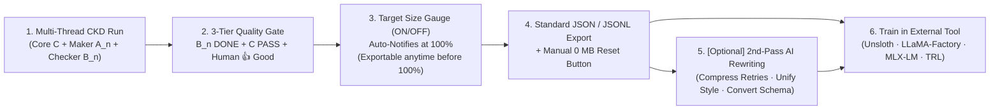

# 🎯 Herdr CKD Fine-Tuning (Collaborative Knowledge Distillation) Architecture & Guide

> **Created by AXNli Inc. (`주식회사 에이엑스엔엘아이` : [https://axnli.com](https://axnli.com))**  
> *Why Herdr CKD separates lightweight verified trajectory collection from heavy model training : and how you can export, customize (even rewrite via another AI), and fine-tune your own local coding models.*

---

## 1. Why We Built the Fine-Tuning Pipeline This Way

True to its name : **CKD (Collaborative Knowledge Distillation)** : one of Herdr CKD's core missions is turning **today's verified problem-solving sessions** (led by Core `C` and audited by `[A_n · B_n]`) into **tomorrow's smarter local LLM**.

When developers try to fine-tune open-weight coding models from standard agent logs, they hit two major walls:

1. **Unverified Trace Pollution ("Garbage In, Garbage Out")**
   - Single-loop agents record their hallucinations, broken edits, and repetitive retry loops right alongside the final answer. Training on raw unverified logs teaches your local model *how to fail*.
   - **Our Solution (3-Tier Verification Funnel)**: Herdr CKD only marks trajectories after **`B_n` (Dedicated Checker `DONE`) → `C` (Final Integration `PASS`) → Human (`👍 Good` Rating)**, and automatically tags `compete`-mode runs with `preferred` vs. `non_preferred` for Direct Preference Optimization (**DPO**).

2. **Avoiding Multi-Gigabyte Training Dependency Bloat**
   - Bundling PyTorch, CUDA, or FlashAttention directly inside a desktop orchestrator bloats installers by tens of gigabytes and breaks across Windows, macOS, and Linux GPU drivers.
   - **Our Solution (Clean Separation via Standard JSON Export)**: Herdr CKD stays ultra-lightweight (**a few megabytes**) by handling **① ON/OFF Toggle, ② Custom Target Size (MB), ③ Automatic 100% Readiness Notification, ④ Standard `.json`/`.jsonl` Export, and ⑤ Manual 0 MB Reset** : leaving actual weight updates to specialized external trainers (`Unsloth`, `LLaMA-Factory`, `MLX-LM`, `LM Studio`, `OpenAI`).

---

## 2. How the `🎯 Fine-Tune` Modal Works (5 Design Principles)

To eliminate any confusion between temporary UI job logs and permanent training data, Herdr CKD hides noisy log counters/cleanup buttons from the top bar (silently managing `jobs/` history in the background via FIFO retention, default `30` jobs / `500 MB` in `⚙️ Settings`) and surfaces a clean, dedicated **`🎯 Fine-Tune`** button governed by five user-first rules:

1. **Explicit `ON / OFF` Control & Automatic Vault Accumulation (No Manual Save Button Needed)**
   - Whenever collection is **`ON`**, you never need to click a separate "Save" button : **every completed run is automatically accumulated into a dedicated Fine-Tuning vault (`finetune/`)**, completely separate from UI history logs (`jobs/`).
   - Don't need fine-tuning data? Flip collection **`OFF`** anytime : zero bytes will be written to `finetune/`.
2. **User-Defined Target Capacity (MB)**
   - Comes with a sensible default (`200 MB`), and lets you set any target size (`10 MB`, `50 MB`, `500 MB`, etc.) matching your training cadence.
3. **Automatic `100%` Readiness Notification (Plus Early Export Anytime)**
   - When `ON` and collected trajectories reach **100%** of your target size, Herdr CKD highlights the top button and opens the modal asking: *"Your Fine-Tuning dataset has reached 100%! Ready to export JSON and fine-tune?"*
   - Want to fine-tune earlier (e.g., at 30%)? You can export `.json` or `.jsonl` **at any time**.
4. **Strict Manual Reset (`0 MB` Initialization : Zero Surprise Deletion)**
   - While regular `jobs/` logs roll over automatically via FIFO retention, your fine-tuning dataset is **never wiped automatically**. Only clicking **`🗑️ Manual Reset (0 MB)`** clears the bucket so you can start collecting your next batch safely.
5. **Role-Specific & Quality-Specific Filtering**
   - Filter by **`👍 Confirmed Good Ratings Only`** or **`All Collected Sessions`**, and slice by role (**`All Roles` / `Maker A Only` / `Checker B Only` / `Core Leader C Only`**) : for example, export `A` to train a pure coder, or `B` to train a dedicated code-review specialist!

---

## 3. ✨ Pro Workflow: 2nd-Pass Customization with Another AI Before Fine-Tuning

Every developer and team has different criteria for **what** their model should learn.  
Because Herdr CKD exports clean, human-readable JSON (`[{"messages": [...], "meta": {...}}]`), you can pass the downloaded `.json` file to a frontier AI (**Claude, Gemini, GPT, etc.**) to **rewrite, filter, or reshape the dataset (`LLM-Assisted Dataset Rewriting`)** before training!

### Four High-Impact AI Rewriting Examples

1. **Compressing Multi-Turn Retries into Clean Single-Shot Trajectories**
   > *"In this exported `herdr-ckd-finetune.json`, some sessions took 2 : 3 fix rounds before passing `B_n`. Strip out intermediate failed attempts and compress each trajectory into a clean, direct `messages` solution while preserving valid tool calls."*
2. **Enforcing Team Coding Conventions & Documentation Style**
   > *"Review all `assistant` code blocks in this JSON file: enforce strict TypeScript types, rename variables to match our style guide, add concise docstrings, and return the updated JSON."*
3. **Masking Private Paths, IPs, and Internal Domains**
   > *"Sanitize this dataset before training our shared model: replace any local user paths (`%USERPROFILE% internal LAN IPs, or proprietary domain names with generic placeholders (`/workspace/app`)."*
4. **Converting into Custom Trainer Schemas (`ShareGPT` / `Alpaca` / `DPO Pairs`)**
   > *"Convert this Herdr CKD JSON file into `ShareGPT` format (`conversations: [{"from": "human", ...}, {"from": "gpt", ...}]`), or pair `preferred` and `non_preferred` units from the same `job_id` into `{prompt, chosen, rejected}` DPO triples."*

---

## 4. Compatible External Fine-Tuning Tools

Load your exported (or AI-refined) `.json` / `.jsonl` dataset directly into any standard fine-tuning tool, then load the resulting GGUF / MLX weights right back into **LM Studio** or **Ollama** as your upgraded **`A·B` Worker Model**:

| External Trainer | Best Environment | Highlights |
| :--- | :--- | :--- |
| **LLaMA-Factory** | Windows / Linux GPU | Drag-and-drop Web UI (`llamafactory-cli webui`) for QLoRA, SFT, and DPO on `.json` / `.jsonl` files |
| **Unsloth** | Single Consumer GPU (8 : 24GB) | 2x faster, low-VRAM LoRA fine-tuning with one-step GGUF export for **LM Studio** & **Ollama** |
| **MLX-LM (`mlx_lm.lora`)** | Apple Silicon Mac (M1 : M5) | Native unified-memory LoRA fine-tuning on macOS |
| **Hugging Face `TRL` / OpenAI** | Cloud GPU or API | Full SFT / `DPOTrainer` pipelines or serverless cloud model fine-tuning |

---

© **AXNli Inc. (`주식회사 에이엑스엔엘아이`)** : [https://axnli.com](https://axnli.com). Licensed under Apache-2.0.
