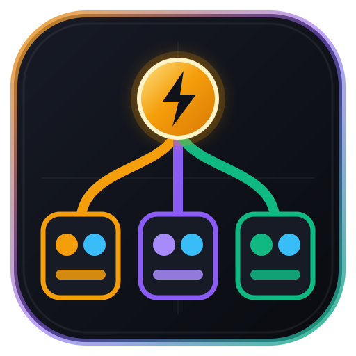
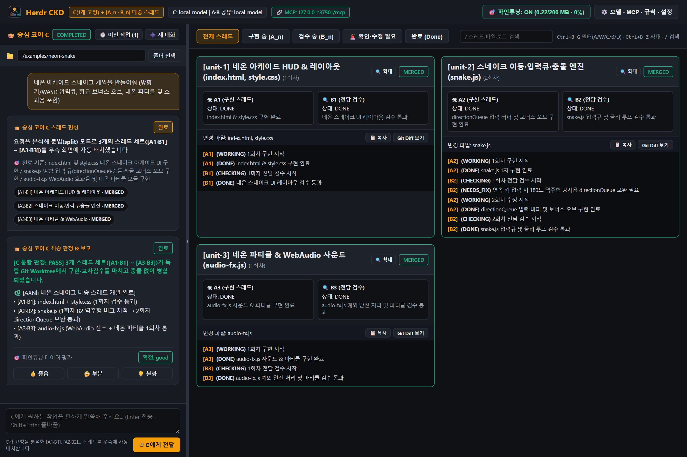
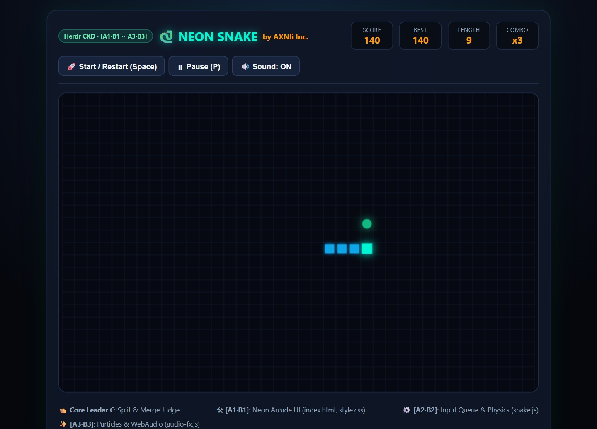
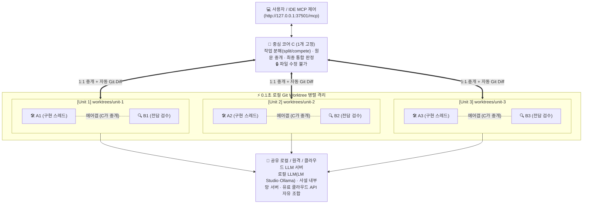

# ⚡ Herdr CKD

<p align="center">
  
</p>

<h3 align="center">
  중심 코어 <code>C (1개 고정)</code> + 다중 스레드 유닛 <code>[A1·B1], [A2·B2], [A3·B3]...</code><br/>
  에어갭 삼권분립 교차검증 & 지식증류 AI 오케스트레이터 (Windows <code>.exe</code> · macOS <code>.app</code> · MCP 서버)
</h3>

<p align="center">
  <strong>Originated & Architected by <a href="https://axnli.com">주식회사 에이엑스엔엘아이 (AXNli Inc.)</a> : <em>Systems for Data & AI</em></strong>
</p>

<p align="center">
  <a href="https://axnli.com"></a>
  <a href="https://github.com/kokogo100/CKD-Architecture"></a>
  <a href="./README.md"></a>
  <a href="./LICENSE"></a>
  <a href="https://nodejs.org/"></a>
  <a href="./herdr-plugin.toml"></a>
  
</p>

---

## 📸 실제 데스크톱 대시보드 & 3-스레드 병렬 개발 화면

<p align="center">
  
</p>
<p align="center">
  <em>▲ <strong>Herdr CKD AI 대화형 데스크톱 대시보드</strong>: 복잡한 설정 선택 없이 자연어로 대화하는 좌측 <code>👑 중심 코어 C</code> 채팅창과, <code>C</code>가 스스로 판단해 자동 배치한 우측 3개 병렬 스레드 유닛(<code>[A1·B1]</code>, <code>[A2·B2]</code>, <code>[A3·B3]</code>) 실시간 관제 화면.</em>
</p>

<p align="center">
  
</p>
<p align="center">
  <em>▲ <strong>3-스레드 자율 편성·교차 검수 실전 결과물 (<code>AXNli Neon Snake</code>)</strong>: Unit 1(<code>A1·B1</code> 아케이드 HUD), Unit 2(<code>A2·B2</code> <code>directionQueue</code> 역주행 방지·보너스 엔진 : 1회차 <code>B2</code> 반려 후 2회차 통과), Unit 3(<code>A3·B3</code> WebAudio·네온 파티클)이 독립 Git Worktree에서 완성 후 병합된 실제 구동 화면.</em>
</p>

---

## 1. 왜 `Herdr CKD`는 일반 AI 서비스 및 에이전트 하네스(Harness)와 완전히 다른가?

> [!IMPORTANT]
> **먼저 알아두세요: 클로드(Claude)·제미나이(Gemini)처럼 "프로젝트 안에 채팅 스레드를 여러 개 열어 쓰는 방식"이 아닙니다!**
> * 일반 AI 서비스(Claude Projects, Gemini, ChatGPT 등)에서 여러 스레드를 여는 것은 **사람이 직접 채팅방을 여러 개 만들어 각 방마다 일일이 지시·관리하는 멀티 채팅 방식**이며, 각 방 안에서는 여전히 AI 혼자 만들고 스스로 맞다고 판단합니다.
> * **Herdr CKD는 다릅니다:** **사용자는 오직 단 하나의 창구(`👑 중심 코어 C`)에게 원하는 목표를 한 번만 편하게 말합니다.** 그러면 `C`가 그 단일 목표를 달성하기 위해 내부적으로 구현 스레드(`A_n`)와 전담 검수 스레드(`B_n`) 세트(**`[A1·B1], [A2·B2], [A3·B3]...`**)를 독립 `Git Worktree`에 자동 편성·배치하고, **구현 ⇄ 전담검수 ⇄ 통합판정**을 모두 마친 뒤 **하나의 완성된 결과물로 병합해 돌려주는 3권분립 검증 엔진**입니다.

**[주식회사 에이엑스엔엘아이 (`AXNli Inc.`)](https://axnli.com)**는 공개 오픈소스 **[Herdr (`OSC 7501`)](https://github.com/herdrdev/herdr)** 터미널 멀티플렉서 규격 위에 독자적인 **`CKD` (삼권분립 교차검증 및 폐쇄루프 지식증류) 이론**을 결합하여 기존 에이전트들의 고질적인 한계를 해결했습니다. (👉 상세 이론 문서: **[`CKD_THEORY.md`](./CKD_THEORY.md)**)

| 비교 항목 | 단일 에이전트 하네스 (`SWE-agent` 등) | 대화방형 멀티에이전트 (`AutoGen`, `CrewAI`) | **⚡ Herdr CKD (`AXNli Inc.`)** |
| :--- | :--- | :--- | :--- |
| **역할 구조** | 에이전트 1명이 코딩·검수 독점 | 여러 에이전트가 한 대화방에서 수다 | **`1개 고정 중심 코어(C)` + `N개 병렬 [A_n · B_n] 세트`** |
| **동조 환각 차단** | ❌ 자기 확증 편향 발생 | ❌ 직접 대화로 인한 집단 맞장구 | ✅ **절대 에어갭(Air-Gap)**: `A_n`과 `B_n` 직접 대화 차단 (`C`만 중개) |
| **권한 분리** | ❌ 모든 도구 무제한 사용 | ⚠️ 프롬프트로만 역할 부여 | ✅ **물리적 도구 박탈**: `B_n`과 `C`는 파일 수정 도구 자체가 없음 |
| **검수 근거** | ⚠️ 작업자 본인의 요약문 | ⚠️ 채팅 메시지 주장 | ✅ **시스템 사실 강제 주입**: `C`가 `A_n`의 실제 `git diff`를 자동 추출해 `B_n`에 전달 |
| **`1회차`의 정의** | 단순 1회 실행 / 재시도 | 대화 1턴 | ✅ **`[A_n ⇄ B_n 둘 다 완료 선언할 때까지 핑퐁]` + `[C의 전체 통합 확인]`** |
| **최종 완성 조건** | 작업자 단독 완료 선언 | 리뷰어 단순 동의 | ✅ **`A(DONE) + B(DONE) + C(PASS)` 3자 만장일치 완료 선언** (`무한 반복` 또는 `N회`) |
| **지식 증류 (재학습)** | ❌ 로그 휘발 | ❌ 대화 기록 휘발 | ✅ **파인튜닝/DPO 정제 데이터셋 (`finetune/curated.jsonl`) 영구 보존** |

---

## 2. `CKD` 1회차(`1 Round`) 수렴 구조 및 아키텍처



### 🔄 CKD `1회차 (1 Round)` 및 만장일치 완성 규칙
1. **내부 핑퐁 루프**: **`C`**가 **`A_n`**에게 지시 → **`C`**가 **`A_n`**이 진행한 것과 `git diff`를 **`B_n`**에게 전달 → **`B_n`**이 검수 후 **"수정(`NEEDS_FIX`) 또는 완료(`DONE`) 선언"** → 문제 시 **`C`**가 다시 **`A_n`**에게 전달하여 수정... 이 과정을 **`A_n`과 `B_n` 모두가 완료(`DONE`)를 선언할 때까지** 반복합니다.
2. **외부 통합 확인 (`= 1회차`)**: **`A_n`**과 **`B_n`**이 완료를 선언했을 때 **`C`가 지금까지 진행한 전체 결과를 다시 확인**하여, 문제가 있으면(`FAIL`) 다시 **`A_n`**에게 전달해 다음 회차 핑퐁을 시작합니다.
3. **3자 만장일치 완성**: **`A`, `B`, `C` 모두가 완료를 선언(`DONE` + `DONE` + `PASS`)하면 비로소 작업이 최종 완성(`completed`)**됩니다. (`♾️ 무한 반복` 기본값 및 `1회 / 3회 / 5회 / 10회 / 20회` 옵션 지원)

---

## 3. 내부망(로컬/사설 LAN) 전용 MCP 보안 설계 및 NPM (`npx`) 지원

* **🔒 100% 로컬 및 사설 내부망 전용 MCP 작동 (외부 클라우드 중계 제로)**
  * Herdr CKD의 MCP 서버(`Streamable HTTP /mcp` 및 `Stdio`)는 **외부 인터넷이나 제3자 클라우드 서버를 전혀 거치지 않고**, 오직 **내 컴퓨터 내부(`127.0.0.1:37501`)** 또는 **동일 공유기/사설 내부망(`192.168.x.x` · Tailscale VPN)** 안에서만 폐쇄적으로 작동합니다.
  * 기본 바인딩은 `127.0.0.1`(로컬 전용)로 잠겨 있으며, 복수의 PC/워크스테이션을 사설 내부망으로 연결할 때만 설정(`uiHost`)에서 내부망 IP를 지정해 안전하게 통신합니다.
* **📦 NPM 패키지(`npx`) 및 로컬 빌드 모두 지원 (`package.json` `bin` 내장)**
  * `package.json`에 `"herdr-ckd"`(대시보드 UI 및 HTTP MCP 런처)와 `"ckd-mcp"`(Stdio MCP 서버) 실행 바이너리가 등록되어 있어, 향후 NPM에 배포하면 누구나 `npx herdr-ckd` 또는 `npm install -g herdr-ckd` 한 줄로도 즉시 실행할 수 있습니다.

---

## 4. 3가지 AI 모델 운용 방식 (유료 AI · 로컬 LLM · 하이브리드) 및 저사양 GPU 보호 모드

Herdr CKD는 **중심 코어 `C`**의 모델 서버 설정(`roleModels.C`)과 **작업·검수 스레드 `A·B`**의 모델 서버 설정(`model`)이 완전히 분리되어 있어, 사용자의 하드웨어 사양과 예산에 맞춰 **3가지 모드**를 원클릭 프리셋으로 자유롭게 선택할 수 있습니다.

| 운용 모드 | 중심 코어 `C` (설계·중개·최종판정) | 스레드 `A · B` (무한 구현·검수 핑퐁) | 특징 및 추천 환경 |
| :--- | :--- | :--- | :--- |
| **① 하이브리드 모드 (강력 추천 ⭐)** | **유료 프론티어 AI**<br/>(`GPT-4.1`, `Gemini 2.5 Pro`, `Claude`) | **무료 로컬 LLM**<br/>(`LM Studio`, `Ollama`, `Llama 3.3` 등) | **`C`는 시작(작업 분할)과 끝(최종 통합 판정)에만 개입하므로 유료 API 토큰이 극소량만 소모**되고, 토큰을 가장 많이 소모하는 **`A_n ⇄ B_n` 무한 구현·검수 핑퐁은 로컬 LLM이 100% 무료로 수행**하는 가성비 최강의 조합입니다. |
| **② 100% 로컬 LLM 모드** | **로컬 LLM**<br/>(`local-model`, `Llama 3.3` 등) | **로컬 LLM**<br/>(`local-model`, `Llama 3.3` 등) | API 비용 **0원**, 사내 보안 코드의 외부 유출 **0%**. 고성능 워크스테이션(대용량 통합 메모리/다중 GPU)에서는 병렬로, 일반 단일 GPU에서는 아래 **저사양 GPU 보호 모드**로 안전하게 구동합니다. |
| **③ 100% 유료 클라우드 AI 모드** | **유료 프론티어 AI**<br/>(`GPT-4.1`, `Gemini 2.5 Pro`, `Claude`) | **유료 경량 고속 AI**<br/>(`GPT-4.1-mini`, `Gemini 2.5 Flash`) | 로컬 GPU가 전혀 없는 일반 노트북·미니 PC에서도 다중 스레드(`3~6개 세트`)를 초고속 병렬로 즉시 가동할 수 있습니다. |

### 🛡️ 로컬 LLM 사용 시 주의사항: 저사양 GPU (Low-VRAM) 보호 옵션 기본 탑재
* **왜 저사양 GPU에서는 다중 스레드 동시 실행이 무거울까요?**
  * 모델 가중치(Weights) 자체는 메모리에 1개만 올라가더라도, 3개 스레드(`[A1·B1]`, `[A2·B2]`, `[A3·B3]`)가 동시에 추론을 요청하면 **KV 캐시(Context 버퍼)가 스레드 수만큼 배수로 늘어나** 일반 그래픽카드(VRAM 8GB~16GB)에서는 메모리 부족(OOM)이나 급격한 속도 저하가 발생할 수 있습니다.
* **Herdr CKD의 저사양 GPU 해결책 (`⚙️ 설정` 모달 또는 MCP 프리셋에서 즉시 활성화)**:
  1. **`🐢 순차 1개씩 실행 (저사양 단일 GPU 보호)` 모드 (`parallelUnits: false`)**:
     * `⚙️ 모델 · MCP · 규칙 · 설정` 창에서 병렬 실행 체크를 해제(또는 MCP `gpu_low_sequential` 프리셋 적용)하면, `C`가 작업을 `[A1·B1]`, `[A2·B2]`, `[A3·B3]` 각각의 `Git Worktree`로 분할·격리하는 과정은 동일하게 유지하되 **GPU에는 한 번에 1개 유닛씩만 순차적으로 추론을 요청**합니다. 단일 GPU에서도 VRAM 폭발 없이 다중 스레드 아키텍처를 완벽히 완주할 수 있습니다!
  2. **자연어 지시 기반 스레드·회차 제어 (`1세트 단독` 또는 `"최대 5회차 안으로 해줘"`)**:
     * 좌측 대화창은 복잡한 드롭다운 없이 자연어로 말만 하면 `C`가 작업 규모에 맞춰 `1~6개 세트`를 알아서 배정하며, 대화 문장에 `"최대 3회차 이내로 완성해줘"`처럼 적거나 MCP `gpu_minimal_single`(`maxUnits: 1`) 프리셋으로 가볍게 구동할 수도 있습니다.

---

## 5. `SOUL.md` · `CATALOG.md` 자동 주입 및 MCP 대시보드 UI 전권 자율 제어

IDE(Antigravity, Gemini CLI, Claude Desktop, Cursor 등)를 Herdr CKD의 MCP(`http://127.0.0.1:37501/mcp` 또는 `Stdio`)에 연결하는 순간, 연결된 AI는 단순한 도구 호출자를 넘어 **대시보드 UI 전체를 사용자를 대신해 알아서 작동시키는 자율 조종사(Autopilot Commander)**가 됩니다.

* **🌌 [`SOUL.md`](./SOUL.md) (`ckd://soul`) : 에이전트 영혼 및 3권분립 헌장 자동 부여**
  * MCP 서버 접속과 동시에 `instructions` 및 `ckd://soul` 리소스를 통해 연결된 AI에게 **`C` + `[A_n · B_n]` 3권분립 원칙, `1회차` 만장일치 수렴 법칙, 대시보드 UI 자율 조작 의무**를 자동으로 주입합니다.
* **📚 [`CATALOG.md`](./CATALOG.md) (`ckd://catalog`) : 이기종 AI 조합 및 GPU 프로파일 카탈로그**
  * `hybrid_openai_local`(`C`=유료 OpenAI + `A·B`=로컬 LLM), `hybrid_gemini_local`, `hybrid_claude_local`, `local_lmstudio`, `local_ollama`, `cloud_openai`, `cloud_gemini` 및 저사양 GPU 보호 프로파일(`gpu_low_sequential`, `gpu_minimal_single`)이 표준 카탈로그로 내장되어 있습니다.
* **🎮 `ckd_ui_control` : MCP로 연결된 AI가 대화형 대시보드 UI 전체를 실시간 원격 조작**
  * 연결된 AI에게 말만 하면 AI가 `ckd_ui_control` 도구를 호출하여 열려 있는 대시보드 화면에서 **① 좌측 `C` 대화창(`프로젝트 폴더`, `작업 지시`, 내부 실행 옵션) 자동 세팅(`set_form`), ② 다중 동시 실행(`⚡ 실행 중 N`) 작업 간 즉시 전환(`select_job`), ③ 스레드 필터 탭 전환(`set_filter`: `all`/`working`/`checking`/`blocked`/`done`), ④ 빠른 검색(`set_search`) 및 개별 스레드 카드 확대(`zoom_unit`), ⑤ 유닛별 `Git Diff` 코드 창 열기/닫기(`toggle_diff`), ⑥ 카탈로그 프리셋 원클릭 적용(`apply_preset`)**까지 화면 전체를 알아서 작동시킵니다.
* **⚡ 원본 Herdr 핵심 UX 및 공식 규격 완벽 내장**
  * **세션 분리 및 즉시 재접속 (`Detach & Reattach`)**: 앱 창을 닫아도 백그라운드 작업과 MCP 연결은 끊기지 않고 유지되며, 다시 실행하면 중복 서버를 띄우지 않고 진행 중인 기존 세션에 즉시 재접속됩니다 (`⚙️ 설정` 내 완전 종료 버튼 지원).
  * **`🚨 확인·수정 필요 (Blocked)` 인박스 & `🔍 확대 보기` & 단축키**: `Ctrl+B G` 후 `A/W/C/B/D` 필터 전환, `Ctrl+B Z` 개별 스레드 카드 전체 확대/축소, `/` 스레드·파일·로그 실시간 검색, **`📜 사용자 커스텀 규칙(Custom Rules)`** 공통 주입, 그리고 공식 **`OSC 7501` (Rev 0.4)** 및 `herdr`/`hc` CLI 규격을 준수합니다.

* **🎯 파인튜닝(협업 지식 증류) 전용 모달 · 자동 누적 금고 · 표준 JSON 추출** (상세 가이드: **[`FINETUNING_GUIDE.md`](./FINETUNING_GUIDE.md)**)
  * **자동 저장 (별도 저장 버튼 불필요)**: 파인튜닝이 **`ON`** 이면 작업을 1회 돌릴 때마다 화면용 최근 작업 기록과는 완전히 분리된 전용 금고(`finetune/`)에 학습용 대화가 자동으로 차곡차곡 누적 저장됩니다.
  * 상단 `🎯 파인튜닝` 전용 모달에서 **① 수집 `ON/OFF` 스위치, ② 사용자 지정 목표 용량(MB) 설정, ③ 100% 도달 시 자동 알림(100% 이전에도 언제든 추출 가능), ④ 외부 파인튜닝 도구(`Unsloth`, `LLaMA-Factory`, `MLX-LM`, `LM Studio` 등)용 표준 `.json`/`.jsonl` 다운로드, ⑤ 수동 `0 MB 리셋`**을 지원합니다.
  * 다운로드한 `.json` 파일을 상위 AI(Claude, Gemini, GPT 등)에 전달해 **시행착오 턴 압축, 사내 코딩 컨벤션 통일, 민감 경로 마스킹, 학습 포맷 변환** 등 사용자 기준에 맞춰 2차 가공한 뒤 파인튜닝하는 워크플로우도 완벽히 지원합니다.

---

## 6. 무소음 백그라운드 디스크 자동 관리 및 3중 저장소 격리 설계

사용자가 대시보드에서 **파인튜닝 데이터**와 **일반 작업 기록(로그)** 을 혼동하지 않도록, 메인 상단 UI에서는 복잡한 로그 용량 수치나 삭제 버튼을 숨기고 **`🎯 파인튜닝`** 과 **`⚙️ 설정`** 만 직관적으로 노출합니다. 대신 백그라운드에서는 디스크 용량이 절대 넘치지 않도록 **3개의 완전히 분리된 공간**으로 자동 관리됩니다:

| 분리된 저장 공간 | 역할 | 삭제 · 보관 정책 |
| :--- | :--- | :--- |
| **① 실제 작업 폴더 (`Workspace`)** | AI 스레드들이 구현·병합한 사용자의 실제 프로젝트 소스코드 | **영구 보존** (어떠한 정리·리셋 기능도 건드리지 않음) |
| **② 화면 조회용 작업 히스토리 (`jobs/`)** | 좌측 `최근 작업 목록`에서 지난 결과를 다시 열어보기 위한 캐시 및 임시 `Git Worktree` | **백그라운드 블랙박스(FIFO) 자동 정리**: 작업 종료 즉시 무거운 임시 `worktrees/`·원격 임시 브랜치를 자동 삭제하며, 최근 30개(최대 500MB, `⚙️ 설정` 및 MCP `ckd_configure`에서 변경 가능 · `ckd_cleanup_logs`로 즉시 비우기 지원)까지만 유지하고 초과분은 오래된 순으로 조용히 자동 정리됨 |
| **③ 파인튜닝 전용 금고 (`finetune/`)** | `ON` 상태일 때 매 작업 종료 시 자동 누적되는 검증된 학습 데이터 (`.json`/`.jsonl` 추출용) | **수동 리셋 전까지 절대 자동 삭제 안 됨**: ②번 작업 히스토리가 백그라운드에서 자동 정리되더라도 파인튜닝 금고는 100% 독립 보존되며, 오직 사용자가 `🎯 파인튜닝` 모달에서 **`수동 리셋`** 을 눌렀을 때만 `0 MB`로 초기화됨 |

### 설치 및 실행 방법

```bash
npm install
npm run build

# Windows 네이티브 실행 파일(Herdr-CKD.exe) 및 배치 런처 생성
npm run build:exe

# macOS 앱 번들(Herdr CKD.app) 생성
npm run build:mac

# 데스크톱 대시보드 + 내부망 Streamable HTTP MCP 서버 실행 (기본 http://127.0.0.1:37501)
npm run ui
```

## License

Apache License 2.0 : Copyright © **AXNli Inc. (`주식회사 에이엑스엔엘아이` : [https://axnli.com](https://axnli.com))**.
