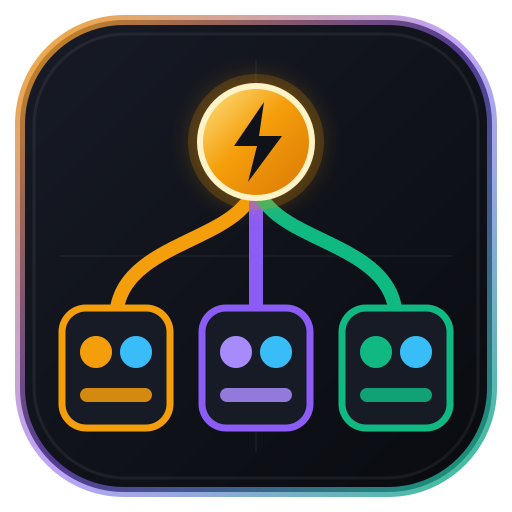
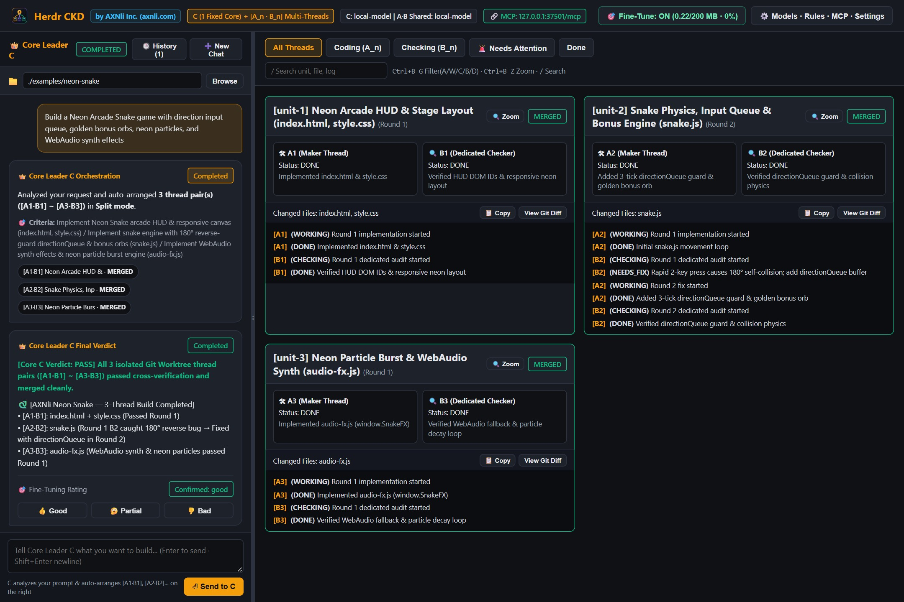
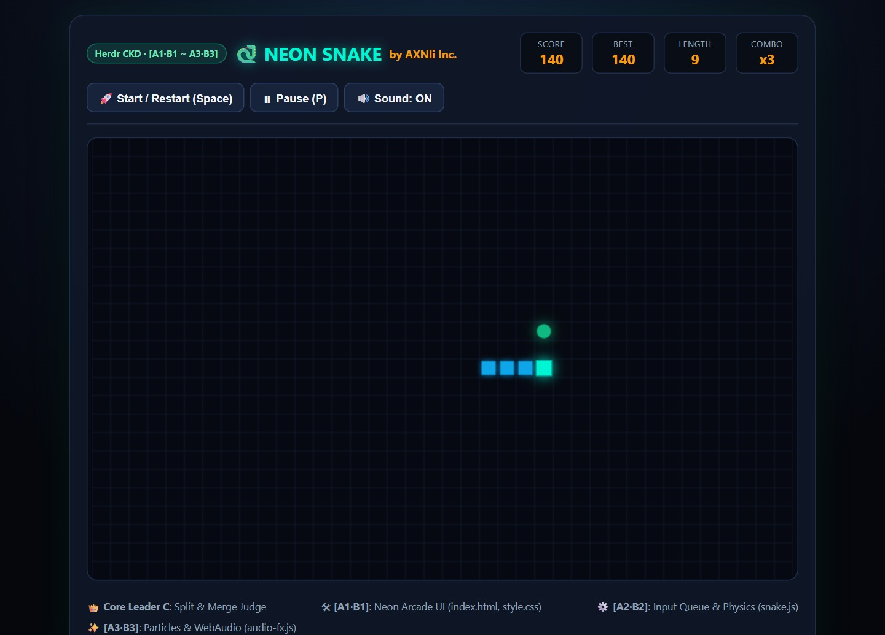
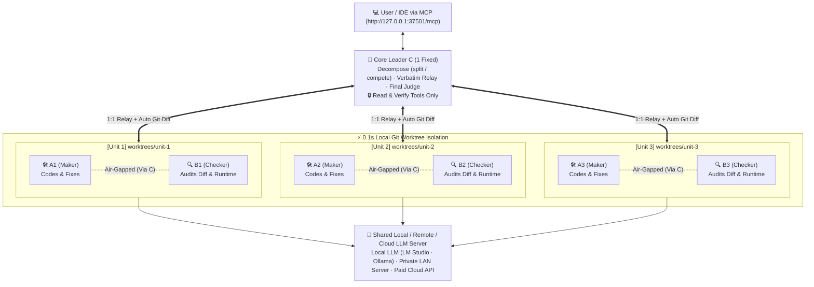

# ⚡ Herdr CKD

<p align="center">
  
</p>

<h3 align="center">
  Air-Gapped Triadic AI Orchestrator & Split-Thread Desktop Dashboard<br/>
  Combining Open-Source <code>Herdr (OSC 7501)</code> with the Proprietary <code>CKD</code> Verification & Distillation Theory
</h3>

<p align="center">
  <strong>Originated & Architected by <a href="https://axnli.com">AXNli Inc. (주식회사 에이엑스엔엘아이)</a> : <em>Systems for Data & AI</em></strong>
</p>

<p align="center">
  <a href="https://axnli.com"></a>
  <a href="https://github.com/kokogo100/CKD-Architecture"></a>
  <a href="./README.ko.md"></a>
  <a href="./LICENSE"></a>
  <a href="https://nodejs.org/"></a>
  <a href="./herdr-plugin.toml"></a>
  
</p>

---

## 📸 Live Desktop Dashboard & Multi-Thread Execution Preview

<p align="center">
  
</p>
<p align="center">
  <em>▲ <strong>Herdr CKD AI-Native Conversational Dashboard</strong>: Zero-config natural-language chat with Fixed Core Leader <code>C</code> on the resizable left panel, and 3 autonomous parallel <code>[A1·B1]</code>, <code>[A2·B2]</code>, <code>[A3·B3]</code> Git Worktree thread pairs auto-arranged on the right (notice Unit 2 catching a 180° reverse self-collision bug via <code>B2 NEEDS_FIX</code> in Round 1 and passing in Round 2).</em>
</p>

<p align="center">
  
</p>
<p align="center">
  <em>▲ <strong>3-Thread Autonomous Build & Cross-Audit Output (<code>AXNli Neon Snake</code>)</strong>: Built and verified simultaneously by Unit 1 (<code>A1·B1</code> Arcade HUD & CSS), Unit 2 (<code>A2·B2</code> <code>directionQueue</code> Physics & Bonus Engine), and Unit 3 (<code>A3·B3</code> WebAudio Synth & Neon Particles), then merged and verified by Core Leader <code>C</code>.</em>
</p>

---

## 1. Why `Herdr CKD` is NOT Multi-Tab Project Chat or Just Another Agent Harness

> [!IMPORTANT]
> **Read This First: Herdr CKD is NOT "Opening Multiple Chat Threads in a Project" like Claude or Gemini!**
> * In standard AI apps (*Claude Projects, Gemini, ChatGPT*), opening "multiple threads" means **a human manually opening several separate chat tabs and micromanaging each conversation** : while inside each tab, a single AI still writes code and judges its own output.
> * **Herdr CKD is fundamentally different:** **You speak to ONLY ONE conversational window (`👑 Core Leader C`) in plain language.** Behind that single request, `C` autonomously spawns isolated `Git Worktree` Maker : Checker pairs (**`[A1·B1], [A2·B2], [A3·B3]...`**), enforces strict **`Maker (A_n) ⇄ Dedicated Checker (B_n)`** cross-verification, and merges the verified work back into **one unified result**.

Most AI coding tools today also fall into two engineering traps:
- **Single-Agent Harnesses (*SWE-agent, Aider, standard IDE agents*)**: The same context window writes code and evaluates its own tests : leading to **Self-Confirmation Bias** (rationalizing bugs or weakening tests to pass).
- **Chat-Room Multi-Agent Swarms (*AutoGen, CrewAI*)**: Agents talk directly to each other in a shared chat room, quickly falling into **Sycophantic Groupthink** where the "Reviewer"rubber-stamps the "Coder's" claims.

**Herdr CKD**, developed by **[AXNli Inc. (`주식회사 에이엑스엔엘아이`)](https://axnli.com)**, solves this by combining the open-source **[Herdr](https://github.com/herdrdev/herdr) (`OSC 7501`)** terminal multiplexing protocol with AXNli's proprietary **`CKD` (Collaborative Knowledge Distillation & Cross-Verified Role Separation) Theory**.

> 📖 **Read the Full Theoretical Paper**: **[`CKD_THEORY.md`](./CKD_THEORY.md)**

### At a Glance: Agent Harnesses vs. Multi-Agent Chat vs. `Herdr CKD`

| Feature | Single-Agent Harness | Chat-Room Multi-Agent | **⚡ Herdr CKD (`AXNli Inc.`)** |
| :--- | :--- | :--- | :--- |
| **Role Architecture** | 1 Agent (`Plan → Code → Check`) | Shared group chat (`A ↔ B ↔ C`) | **`1 Fixed Core C` + `N Parallel [A_n · B_n] Thread Pairs`** |
| **Peer Contagion Prevention** | ❌ None (same context) | ❌ Direct peer chat causes groupthink | ✅ **Strict Air-Gap**: `A_n` (Maker) and `B_n` (Checker) **never** talk directly; `C` relays verbatim |
| **Runtime Tool Separation** | ❌ Full write access everywhere | ⚠️ Prompt-only personas | ✅ **Physical Tool Stripping**: `B_n` and `C` cannot call `write_file` or `edit_file` |
| **Anti-Hallucination Evidence** | ⚠️ Self-reported summary | ⚠️ Self-reported chat message | ✅ **System Fact Injection**: `C` auto-attaches raw `git diff` from `A_n`'s worktree to `B_n` |
| **`1-Round` Definition** | 1 tool step / 1 retry | 1 chat turn | ✅ **`[Inner A_n ⇄ B_n Loop until both DONE]` + `[Outer Integration Audit by C]`** |
| **Completion Criterion** | Agent claims "Done" | Reviewer says "LGTM" | ✅ **Unanimous Triad (`A = DONE` ∧ `B = DONE` ∧ `C = PASS`)** (Infinite `0` or `N`-Round cap) |
| **Knowledge Distillation** | ❌ Logs discarded | ❌ Transcripts discarded | ✅ **Auto-Curated SFT/DPO Dataset (`finetune/curated.jsonl`)** for local LLM retraining |

---

## 2. The `CKD` Triadic Architecture & `1-Round` Convergence Loop

### 2.1 Role Topology: `C (1 Fixed Core)` + `[A1·B1], [A2·B2], [A3·B3]...`



### 2.2 What Defines `1 Round` (`1회차`) and When is a Job Complete?

In **CKD Theory**, speed without verification is meaningless. Therefore, a single round (`1 Round`) is defined as a complete two-tier convergence cycle:

1. **Inner Ping-Pong (`C → A_n → C → B_n → C → A_n ...`)**:
   - **`C`** instructs **`A_n`** (Maker).
   - **`C`** takes what **`A_n`** implemented, automatically extracts the objective `git diff`, and relays it to **`B_n`** (Checker).
   - **`B_n`** audits the code/runtime and declares either **"Needs Fix (`NEEDS_FIX`)"** or **"Done (`DONE`)"**.
   - If there is any problem, **`C`** relays **`B_n`**'s exact findings back to **`A_n`**, and **`A_n`** fixes the code.
   - This inner ping-pong repeats **until both `A_n` and `B_n` declare `DONE`**.
2. **Outer Final Verification by `C` (`= End of 1 Round`)**:
   - Once **`A_n`** and **`B_n`** both declare `DONE`, **`C`** inspects the combined work accomplished so far.
   - If **`C`** finds any integration issue (`FAIL`), **`C`** sends instructions back to **`A_n`** to restart the `A_n ⇄ B_n` ping-pong (`Round 2`).
   - If **`C`** confirms everything is sound (`PASS`), then **all three roles (`A`, `B`, and `C`) have declared completion**, and the job is officially finished (`completed`)!
3. **Infinite Loop (`maxRounds: 0`) or Explicit N-Round Cap (`1`, `3`, `5`, `10`, `20` Rounds)**:
   - Select **`♾️ Infinite Loop (Until A · B · C All Declare DONE)`** (`0`, default) or set an explicit round cap in the Dashboard UI or via MCP (`max_rounds: 10`).

---

## 3. Key Engineering Capabilities

- **Single-Model Shared Memory & Private LAN Control**:
  - Load your local model **once** on LM Studio, Ollama, MLX, or `llama-server` (locally or on a private LAN workstation) and connect `Herdr CKD` (`http://localhost:1234/v1` or `http://<lan-ip>:1234/v1`) with **zero duplicate model weight memory**, or mix Paid Cloud AI (`C`) + Local LLM (`A·B`).
- **Herdr-Native UX (`Detach & Reattach`, `Blocked` Inbox, `Pane Zoom`, `Ctrl+B` Chords, `OSC 7501` Rev 0.4)**:
  - Closing the desktop window detaches cleanly while background threads and MCP stay alive; relaunching `Herdr-CKD.exe` / `npm run ui` immediately **reattaches** to the running session without spawning duplicate servers. Includes **`🚨 Needs Attention (Blocked)`** inbox filter, **`🔍 Zoom` (`Ctrl+B Z`)**, **`Ctrl+B G` (`A/W/C/B/D`)** filter chords, **`/` instant search**, **`📋 Copy` unit logs**, and **`📜 Custom Rules`**.
- **Two Multi-Thread Execution Modes**:
  - **`split` (Divide & Conquer)**: `C` partitions a project into non-overlapping files across `[A1·B1]..[An·Bn]`, merges passing Git Worktrees, and verifies the integrated whole.
  - **`compete` (Best-of-N Tournament)**: `C` assigns the same hard bug/algorithm to multiple `[A_n · B_n]` units in parallel, adopts the best passing unit (`winner_unit_id`), and tags trajectories with `preferred` vs. `non_preferred` for DPO fine-tuning.
- **🔒 100% Local & Private Internal-Network MCP Architecture (Zero External Cloud Relay)**:
  - **Strictly Internal Operation**: The built-in MCP server (`Streamable HTTP` on `/mcp` and `Stdio`) operates **exclusively within your local machine (`127.0.0.1`) or your private internal network (`192.168.x.x` / Tailscale LAN)**. Zero code, prompts, or `git diff` data ever pass through an external third-party relay server.
  - **Collision-Free Configurable Port (`37501`)**: Uses uncommon port `37501` by default (inspired by `OSC 7501`) so it never collides with standard dev servers (`3000`, `5173`, `8080`). Both `uiHost` and `uiPort` are configurable via the Settings modal or `ckd_configure`.
  - **Live IDE-to-Dashboard Sync**: Control everything directly from **Gemini (Antigravity), Claude Code, Cursor, or Windsurf** via `http://127.0.0.1:37501/mcp` while watching live `[A_n · B_n]` thread progress in the desktop window.
- **Silent Background Auto-Cleanup & 3-Way Storage Isolation**:
  - To keep the Dashboard UI clutter-free and eliminate confusion between **job history logs** and **fine-tuning datasets**, log storage counters/buttons are intentionally hidden from the top bar (leaving only `🎯 Fine-Tune` and `⚙️ Settings`).
  - Behind the scenes, Herdr CKD automatically deletes heavy temporary `worktrees/` and `ckd/*` branches immediately upon completion (`deleteBranchOnComplete: true`), silently prunes old `jobs/` history in FIFO black-box order (`maxJobsToKeep: 30`, `maxLogSizeMB: 500` : customizable in `⚙️ Settings` or via MCP `ckd_configure` / `ckd_cleanup_logs`), and **never touches your actual `Workspace` code or your isolated `finetune/` vault**.

---

## 4. Quick Start & Installation

### 4.1 Install & Run from Source

```bash
npm install
npm run build

# Launch the Split-Thread Desktop Dashboard + Streamable HTTP MCP Server (http://127.0.0.1:37501)
npm run ui

# Or run as a Stdio MCP Server (automatically bridges to the live UI if open)
npm start
```

### 4.2 Build Native Desktop Launchers (Windows `.exe` & macOS `.app`)

```bash
# Windows: Compiles native GUI launcher Herdr-CKD.exe (with custom multi-res icon) + Herdr-CKD.bat
npm run build:exe

# macOS: Builds standard macOS bundle "Herdr CKD.app" + Herdr-CKD.command
npm run build:mac
```

### 4.3 Connect Your IDE via MCP (Internal Network / Localhost Only)

> **Security Note**: Herdr CKD's MCP server runs 100% locally on your machine (`127.0.0.1:37501`) or across your private internal LAN (`192.168.x.x` / Tailscale). It does not require or connect to any external cloud proxy.

#### Option A: Streamable HTTP MCP (Recommended when Desktop UI is open)
```json
{
  "mcpServers": {
    "herdr-ckd": {
      "url": "http://127.0.0.1:37501/mcp"
    }
  }
}
```

#### Option B: Via `npx` / Global NPM Package (Once published to npm)
```json
{
  "mcpServers": {
    "herdr-ckd": {
      "command": "npx",
      "args": ["-y", "herdr-ckd", "ckd-mcp"],
      "env": {
        "CKD_DATA_DIR": "/absolute/path/to/herdr-ckd-data"
      }
    }
  }
}
```

#### Option C: Direct Local Node Stdio MCP (Auto-bridges to Live UI)
```json
{
  "mcpServers": {
    "herdr-ckd": {
      "command": "node",
      "args": ["/absolute/path/to/Herdr-CKD-EN/dist/src/server.js"],
      "env": {
        "CKD_DATA_DIR": "/absolute/path/to/Herdr-CKD-EN/herdr-ckd-data"
      }
    }
  }
}
```

---

## 5. MCP Tools Reference

| Tool Name | Description |
| :--- | :--- |
| `ckd_ui_control` | **Autonomous Live UI Control & Catalog Preset Engine**: Allows the MCP-connected AI to remotely operate the entire open Dashboard UI (`set_form`, `select_job`, `set_filter` including `blocked`, `set_search`, `zoom_unit`, `toggle_diff`, `apply_preset` from `CATALOG.md`, `open_settings`, `close_settings`, `get_soul_and_catalog`). |
| `ckd_multi_run` | Launch a multi-thread job (`C` + `[A1·B1], [A2·B2]...`) in `auto`, `split`, or `compete` mode (`max_rounds: 0` for infinite loop until A·B·C all declare DONE, or e.g. `10` for 10 rounds). Automatically populates and selects the job on the live UI. |
| `ckd_multi_status` | Inspect live progress, per-unit logs, and `Git Diff` (`include_diff: true`). |
| `ckd_multi_review` | Approve (`accept`) or request rework (`rework`) on a job in `awaiting_review`. |
| `ckd_multi_stop` | Stop a running multi-thread job. |
| `ckd_configure` | View or update `uiHost`, `uiPort` (`37501`), Leader/Worker URLs & API Keys (`leaderUrl`, `leaderApiKey`, `workerUrl`, `workerApiKey`), `parallelUnits` (Low-VRAM protection), `maxUnits`, `maxRounds`, GitHub sync, and FIFO retention limits. |
| `ckd_check_models` | Test connectivity and model availability for Core Leader `C` and shared Worker `A·B` servers. |
| `ckd_feedback` | Lock human quality rating (`correct` / `partial` / `incorrect`) into `finetune/curated.jsonl`. |
| `ckd_cleanup_logs` | Immediately trigger FIFO log retention and temporary worktree cleanup. |

### 🌌 Built-In `SOUL.md` (`ckd://soul`) & `CATALOG.md` (`ckd://catalog`) MCP Resources
When an external AI connects to Herdr CKD via MCP, it automatically receives:
1. **[`SOUL.md`](./SOUL.md) (`ckd://soul`)**: The Agent Soul & Autonomous Command Charter : defining the `C` + `[A_n · B_n]` separation of powers, the `1-Round` unanimous convergence law, and the mandate to operate the Dashboard UI hands-free on behalf of the user.
2. **[`CATALOG.md`](./CATALOG.md) (`ckd://catalog`)**: Ready-to-apply presets for heterogeneous AI role mixing (`hybrid_openai_local`, `hybrid_gemini_local`, `hybrid_claude_local`, `local_lmstudio`, `local_ollama`, `cloud_openai`, `cloud_gemini`), Low-VRAM GPU concurrency profiles (`gpu_low_sequential`, `gpu_minimal_single`, `gpu_high_parallel`), and live UI remote control actions.

---

## 6. Three Flexible AI Deployment Modes (Paid AI · Local LLM · Hybrid) & Low-VRAM GPU Protection

Because Herdr CKD decouples **Core Leader `C`** (`roleModels.C`) from **Shared Worker Threads `A · B`** (`model`), you can mix and match cloud APIs and local LLMs with one-click presets in the Settings modal:

| Deployment Mode | Core Leader `C` (Plan · Relay · Final Judge) | Worker Threads `A · B` (Unlimited Inner Ping-Pong) | Best For & Key Advantage |
| :--- | :--- | :--- | :--- |
| **① Hybrid Mode (Recommended ⭐)** | **Paid Frontier AI**<br/>(`GPT-4.1`, `Gemini 2.5 Pro`, `Claude`) | **Free Local LLM**<br/>(`LM Studio`, `Ollama`, `Llama 3.3`, etc.) | **`C` only runs at the start (task split) and end of a round (final integration judgment) : using minimal paid tokens**, while the token-heavy, repetitive **`A_n ⇄ B_n` inner coding/testing loop runs 100% free on your Local LLM**. |
| **② 100% Local LLM Mode** | **Local LLM**<br/>(`local-model`, `Llama 3.3`, etc.) | **Local LLM**<br/>(`local-model`, `Llama 3.3`, etc.) | **$0 API cost** and **100% air-gapped code privacy**. Use Parallel mode on high-VRAM workstations (e.g., Apple Silicon unified memory / multi-GPU) or **Sequential Low-VRAM Mode** on single consumer GPUs. |
| **③ 100% Paid Cloud AI Mode** | **Paid Frontier AI**<br/>(`GPT-4.1`, `Gemini 2.5 Pro`, `Claude`) | **Paid Fast Cloud AI**<br/>(`GPT-4.1-mini`, `Gemini 2.5 Flash`) | Run 3~6 `[A_n · B_n]` thread pairs in ultra-fast parallel even on lightweight laptops with no dedicated GPU. |

### 🛡️ Hardware Guide for Local LLMs: Built-In Low-VRAM GPU Protection
* **Why can parallel local LLM threads overload a single consumer GPU?**
  * Even when a single model weight is shared in memory, firing 3~6 concurrent inference streams (`Promise.all` across `[A1·B1]`, `[A2·B2]`, `[A3·B3]`) multiplies the active **KV-cache (context buffer) footprint**, which can cause VRAM Out-Of-Memory (OOM) or severe throttling on 8GB : 16GB consumer GPUs.
* **Built-In Solutions in Herdr CKD (Configurable in `⚙️ Settings` or via MCP Presets)**:
  1. **`🐢 Sequential 1-by-1 (Low-VRAM Single GPU Safe)` Mode (`parallelUnits: false`)**:
     * Toggle off parallel unit execution in `⚙️ Models · Rules · MCP · Settings` (or apply the `gpu_low_sequential` preset via MCP). Core Leader `C` still decomposes the project into isolated `Git Worktree` units (`[A1·B1]`, `[A2·B2]`, `[A3·B3]`), but executes them **one unit at a time sequentially** (`[A1·B1]` finishes → `[A2·B2]` starts) so your GPU only ever holds a single active inference slot in VRAM!
  2. **Zero-Config Natural-Language Sizing & Round Caps (`gpu_minimal_single` or `"within 5 rounds max"`)**:
     * No manual dropdowns are needed on the left chat panel : `C` autonomously sizes `1` to `6` `[A_n · B_n]` pairs based on your prompt, supports natural-language round caps (e.g., *"finish within 3 rounds max"*), and handles concurrent multi-job execution (`⚡ Running N` live switcher).

---

## 7. Fine-Tuning (Knowledge Distillation) JSON Export & 2nd-Pass AI Curation

> 📖 **Full Deep-Dive & GitHub Guide**: See **[`FINETUNING_GUIDE.md`](./FINETUNING_GUIDE.md)** for the complete architecture, external trainer table, and copy-paste AI rewriting prompts.

- **Automatic Vault Accumulation + Standard `.json` / `.jsonl` Exporter**: When **`ON`**, no separate "Save" button is needed : every run automatically accumulates into a dedicated `finetune/` vault (independent of UI history logs). Set your **Target Size (MB)**, get notified at **100%** (or export anytime earlier), and reset to `0 MB` strictly via the **Manual Reset** button.
- **3 Isolated Storage Spaces (Zero Cross-Deletion Risk)**:

| Storage Space | Purpose | Retention & Cleanup Policy |
| :--- | :--- | :--- |
| **① User `Workspace`** | Your actual project source code built & merged by `[A_n · B_n]` | **100% Untouched** by any log cleanup or dataset reset |
| **② UI Job History (`jobs/`)** | Powers the left-panel *Recent Jobs* viewer & temporary `Git Worktrees` | **Silent Background FIFO Auto-Pruning**: Heavy temp `worktrees/` are deleted immediately on job completion; rolling history keeps up to `30` jobs / `500 MB` by default (configurable in `⚙️ Settings` or MCP `ckd_configure`, and manually clearable via `ckd_cleanup_logs`) without cluttering the top UI |
| **③ Fine-Tuning Vault (`finetune/`)** | Verified `C · A_n · B_n` trajectories accumulated automatically when **`ON`** | **Never Auto-Deleted**: Completely immune to background `jobs/` pruning; resets to `0 MB` **only** when you click **Manual Reset** inside the `🎯 Fine-Tune` modal |
- **2nd-Pass AI Rewriting Workflow**: Because every user has different training goals, you can pass the exported `.json` file to another AI (Claude, Gemini, GPT, etc.) to compress multi-turn retries into clean single-shot trajectories, unify coding conventions, mask local paths, or convert into `ShareGPT` / `DPO` schemas before training in **Unsloth, LLaMA-Factory, MLX-LM, or OpenAI Fine-tuning**.

---

## 8. About AXNli Inc. (`주식회사 에이엑스엔엘아이`)

**[AXNli Inc.](https://axnli.com)** (`주식회사 에이엑스엔엘아이`) designs and builds production systems where data and AI actually work inside real-world operations : spanning backend & system architecture, multi-agent workflow automation, and closed-loop AI retraining pipelines.

- **Official Website**: [https://axnli.com](https://axnli.com)
- **Creator of the `CKD` Theory & `Herdr CKD`**: AXNli Inc. (`주식회사 에이엑스엔엘아이`)
- **Open-Source Interoperability**: Built on top of the open-source [Herdr](https://github.com/herdrdev/herdr) (`OSC 7501`) terminal agent standard.

## License

Licensed under the [Apache License, Version 2.0](./LICENSE). Copyright © **AXNli Inc. (`주식회사 에이엑스엔엘아이`)**.
